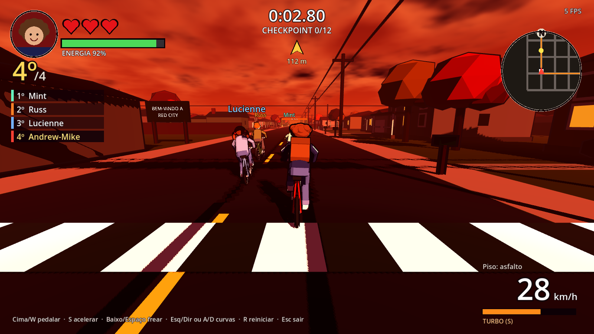

# Urban Riders

Corrida 3D de bicicletas em **Red City** — Godot 4 + GDScript tipado, para macOS.

> **Estado atual:** Fase 4 — corrida completa contra Lucienne, Russ e Mint (IA) no bairro de Red City.
> Personagem e cenário são **geometria provisória** (visual definitivo fica para a versão 2).



## Como jogar no Mac

1. Baixe a **Godot 4** (versão estável, edição padrão — *não* a .NET) em <https://godotengine.org/download/macos/>
   e arraste `Godot.app` para **Aplicativos**. Na primeira abertura: clique com o botão direito → **Abrir**.
2. Baixe o projeto:
   ```bash
   git clone -b claude/adoring-mccarthy-f6kfvr https://github.com/andrellsantana/urbanriders.git
   ```
   (Se já tiver a pasta: `git pull`.)
3. Na Godot: **Importar** → selecione `urbanriders/project.godot` → **Importar e Editar**.
   Se a Godot perguntar sobre converter/atualizar o projeto para a versão nova, aceite.
4. Pressione **Cmd + B** (ou clique no botão ▶ no canto superior direito) para jogar.
   *(No Mac, F5 só funciona como **fn + F5**.)*
5. Para a pista de testes da física: abra `scenes/test_track.tscn` e pressione **Cmd + R** (rodar cena atual).

## Controles

| Tecla | Ação |
|---|---|
| **↑** ou **W** (segurar) | Pedalar (ritmo normal, ~24 km/h) |
| **S** (segurar) | Acelerar gradualmente até 40 km/h (gasta mais energia) |
| **↓** ou **Espaço** | Frear (progressivo) |
| **← →** ou **A D** | Curvas |
| **R** | Reiniciar |
| **Esc** | Sair |

## O que testar

**Rivais (IA):**
- **Mint** (verde-menta): competitiva e limpa — boas curvas, administra a energia, abre espaço e não encosta.
- **Lucienne** (azul): cautelosa nas curvas, rápida nas retas (usa muito turbo) e imprevisível (muda de faixa sem aviso).
- **Russ** (laranja): trapaceiro — **persegue você**: segura o ritmo para te esperar, fecha a sua frente
  ("Sai da frente!"), joga a bicicleta em cima ("Abre!"), devolve ultrapassagens ("Volta aqui!") e corta esquinas pela calçada.
  Encostões **empurram**; trombada forte **derruba**.
- Posição ao vivo à esquerda; rivais aparecem como pontos coloridos no minimapa; quadro final com tempos.

**Corrida no bairro (cena principal):**
- Contagem 3-2-1-JÁ!, depois siga a **seta amarela** no topo e o **minimapa** (canto superior direito).
- Passe pelos **12 checkpoints em ordem** (portal com cortina amarela) e cruze a **LARGADA/CHEGADA**.
- Ruas fora da rota estão fechadas por **barreiras laranja e brancas**.
- **Poças** (manchas vermelhas) perto de duas esquinas e numa reta: curva rápida nelas derruba.
- Andar na contramão mostra **SENTIDO ERRADO!**. Três quedas = corrida perdida.
- Ao chegar: classificação final, tempo e **recorde** (salvo no computador).
- **Energia:** pedalando normal ela gasta muito pouco (~7% por minuto) e **não** recupera;
  só recupera com o **pedal solto**, freando ou parado (seta verde "recuperando" ao lado da barra).
  O turbo (S) é o que esgota. Abaixo de 25% a velocidade máxima cai.
- Os rivais seguem a mesma regra: você os verá **soltar o pedal** para recuperar ("recuperando" sobre o nome)
  e ficar "cansado/cansada" quando exageram.

**Pista de testes** (`scenes/test_track.tscn`): slalom de cones, rampa, piso molhado, grama e muros.

## Testes automatizados

```bash
./tests/run_tests.sh
```
(ou `GODOT=/Applications/Godot.app/Contents/MacOS/Godot ./tests/run_tests.sh`)

## Documentação

- [Arquitetura](docs/ARQUITETURA.md)
- [Plano de fases](docs/PLANO.md)
- [Personagens e direção de arte](docs/PERSONAGENS.md)
- [Registro de alterações](docs/CHANGELOG.md)
