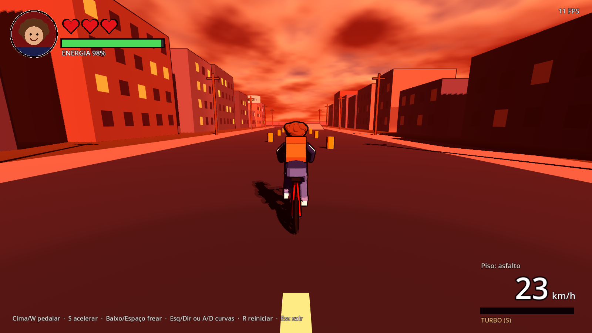

# Urban Riders

Corrida 3D de bicicletas em **Red City** — Godot 4 + GDScript tipado, para macOS.

> **Estado atual:** protótipo da Fase 1–2 (bicicleta, câmera e pista de testes).
> Personagem e cenário são **geometria provisória**.



## Como jogar no Mac

1. Baixe a **Godot 4** (versão estável, edição padrão — *não* a .NET) em <https://godotengine.org/download/macos/>
   e arraste `Godot.app` para **Aplicativos**. Na primeira abertura: clique com o botão direito → **Abrir**.
2. Baixe o projeto:
   ```bash
   git clone -b claude/adoring-mccarthy-f6kfvr https://github.com/andrellsantana/urbanriders.git
   ```
   (Se já tiver a pasta: `git pull`.)
3. Na Godot: **Importar** → selecione `urbanriders/project.godot` → **Importar e Editar**.
   Se a Godot perguntar sobre converter/atualizar o projeto para a versão nova, aceite.
4. Pressione **F5** (ou o botão ▶ no canto superior direito) para jogar.

## Controles

| Tecla | Ação |
|---|---|
| **↑** ou **W** (segurar) | Pedalar (ritmo normal, ~24 km/h) |
| **S** (segurar) | Acelerar gradualmente até 40 km/h (gasta mais energia) |
| **↓** ou **Espaço** | Frear (progressivo) |
| **← →** ou **A D** | Curvas |
| **R** | Reiniciar |
| **Esc** | Sair |

## O que testar na pista

- **Avenida:** pedalar, acelerar com S, frear e fazer curvas; veja a inclinação nas curvas.
- **Cones (slalom):** zigue-zague logo após a largada.
- **Postes e prédios:** bater rápido derruba (perde um coração); encostar devagar não.
- **Rampa** (lado direito da avenida): subida reduz a velocidade, descida acelera.
- **Asfalto molhado** (roxo, à esquerda no fim da avenida) e **grama** (à direita): menos aderência —
  curva fechada em alta velocidade derrapa e derruba.
- **Energia:** turbo contínuo esgota a energia → "CANSADO!" e sem turbo até recuperar.
- **Três quedas** = perde a corrida.
- **Câmera:** de costas, garoto e bicicleta inteiros; não atravessa paredes.

## Testes automatizados

```bash
./tests/run_tests.sh
```
(ou `GODOT=/Applications/Godot.app/Contents/MacOS/Godot ./tests/run_tests.sh`)

## Documentação

- [Arquitetura](docs/ARQUITETURA.md)
- [Plano de fases](docs/PLANO.md)
- [Personagens e direção de arte](docs/PERSONAGENS.md)
- [Registro de alterações](docs/CHANGELOG.md)
